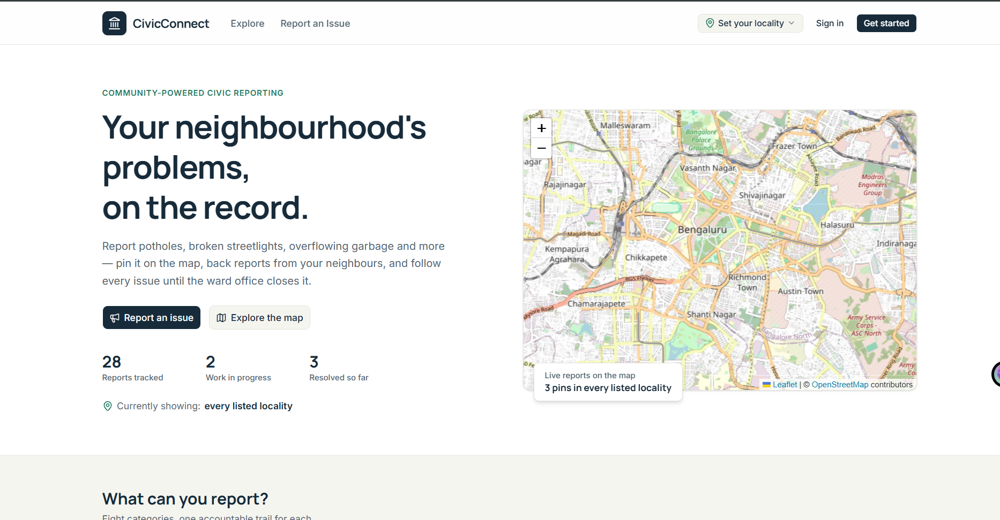
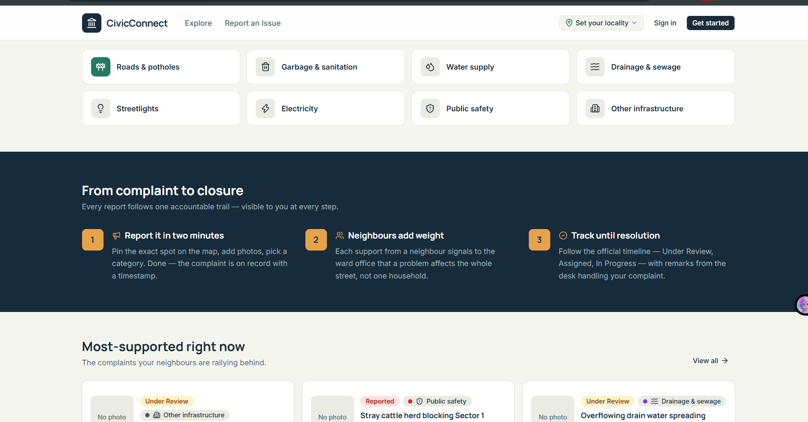
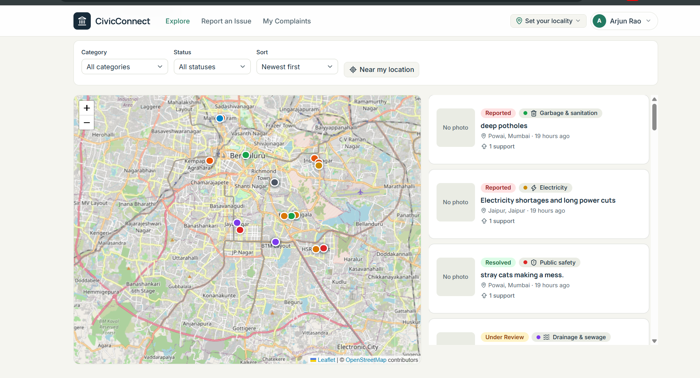
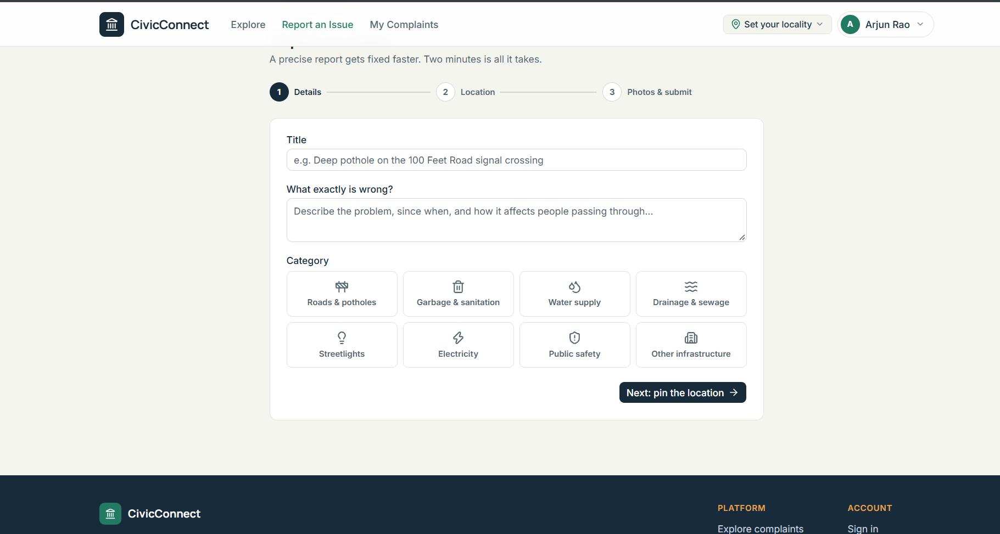

# CivicConnect

CivicConnect is a locality-based civic issue reporting app. Residents can report and map neighbourhood problems, support complaints, and follow status updates. Municipal administrators can manage reports and attach resolution evidence.

**Live demo:** [Open CivicConnect on Emergent](https://fixmystreet-15.emergent.host/?utm_source=share)

## Application screenshots

<table>
  <tr>
    <td align="center"><strong>Home and locality overview</strong><br></td>
    <td align="center"><strong>Categories and reporting workflow</strong><br></td>
  </tr>
  <tr>
    <td align="center"><strong>Explore issues on the map</strong><br></td>
    <td align="center"><strong>Report an issue</strong><br></td>
  </tr>
</table>

## Stack

- Frontend: React 19, TypeScript, Vite, TanStack Query, Leaflet
- Backend: FastAPI, Pydantic, Motor
- Database: MongoDB

## Requirements

- Node.js and Corepack
- Python 3.12 or newer
- A MongoDB instance reachable from the backend

## Setup on Windows

### 1. Configure MongoDB

Copy `backend/.env.example` to `backend/.env`. Set `MONGO_URL` to your MongoDB connection URI. Keep the `.env` file private; it is excluded by `.gitignore`. Set `SESSION_SECRET` to a fresh random value, for example:

```powershell
python -c "import secrets; print(secrets.token_urlsafe(48))"
```

Copy the printed value into `SESSION_SECRET` in `backend/.env`. `DB_NAME` defaults to `civicconnect`; `CORS_ORIGINS` defaults to `http://localhost:3000`.

### 2. Install frontend packages

From the `frontend` directory:

```powershell
corepack yarn@1.22.22 install --frozen-lockfile
```

### 3. Install backend packages

From the `backend` directory:

```powershell
python -m venv .venv
.\.venv\Scripts\python.exe -m pip install -r requirements.txt
```

In VS Code, select `backend/.venv/Scripts/python.exe` as the Python interpreter. The workspace settings use this interpreter by default.

## Run locally

Open two PowerShell terminals.

Backend terminal:

```powershell
cd backend
.\.venv\Scripts\python.exe -m uvicorn server:app --host 127.0.0.1 --port 8001 --reload
```

Frontend terminal:

```powershell
cd frontend
npm.cmd run dev -- --host 127.0.0.1
```

Open `http://localhost:3000`. The Vite server proxies `/api` requests to the backend on port `8001`.

MongoDB must be reachable for registration, login, complaints, and admin features. The API root at `http://localhost:8001/api/` can be used as a basic backend health check.

## Checks

From `frontend`:

```powershell
npm.cmd run typecheck
npm.cmd run build
```

From `backend`:

```powershell
.\.venv\Scripts\python.exe -m pytest
```

The backend tests use the running API at `http://localhost:8001` (configurable with `BACKEND_URL`).

## Repository hygiene

Do not commit `backend/.env`, virtual environments, `node_modules`, or build output. Never put database credentials or session secrets in source files or commit history.
